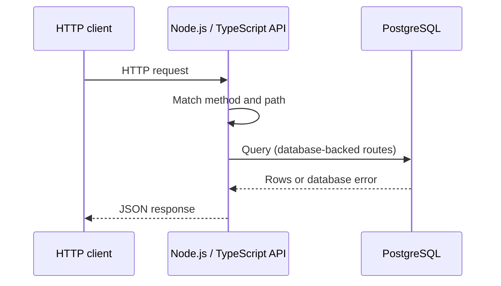
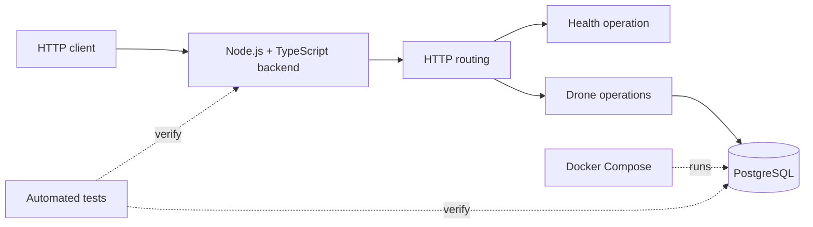

# FlightStack

FlightStack is an evolving **civilian Real-time Drone Operations Platform** for commercial fleets — surveying, inspection, logistics, agriculture, and research. A single project that grows from a simple HTTP API into live telemetry, mission workflows, geospatial operations, event-driven pipelines, cloud deployment, AI-assisted ops, and edge device integration.

A production-shaped system that teaches engineering in layers: each version solves a real problem the previous one handles poorly, without rewriting from scratch.

## Where this is going

Over time, FlightStack is intended to support:

- drone registry, missions, and command history;
- telemetry ingestion, storage, and playback;
- live maps, routes, geofences, and spatial queries;
- realtime updates to flight controllers and operations dashboards;
- reliable event processing (ordering, retries, idempotency);
- secure multi-user access and audit trails;
- cloud deployment with observability and runbooks;
- AI-assisted anomaly summaries and operational tooling;
- physical telemetry from edge hardware over MQTT.

One codebase, one data model, one operational story — expanded incrementally.

## Evolution path

| Version | Architecture         | Focus                                  |
| ------- | -------------------- | -------------------------------------- |
| V0      | Node.js → PostgreSQL | HTTP, API, SQL, tests                  |
| V1      | + Redis, WebSocket   | state, realtime, reconnect             |
| V2      | + geospatial         | PostGIS, coordinates, spatial indexes  |
| V3      | + event broker       | events, ordering, idempotency, retries |
| V4      | + AWS, Terraform     | cloud, IAM, networking, IaC            |
| V5      | + OpenTelemetry      | logs, metrics, traces, reliability     |
| V6      | + RAG, tools, agents | AI systems, evals, permissions         |
| V7      | + ESP32, MQTT        | edge sensors, hardware failures        |

The active version is always documented in [Current phase](#current-phase-v0) below.

Add a layer when the current version clearly fails at a concrete job.

## Current phase: V0

V0 establishes a clear **HTTP + PostgreSQL** foundation: a Node.js/TypeScript backend, a reproducible local database, and tests that verify the service and database boundaries.

### In scope

- **Node.js** — runs the backend process.
- **TypeScript** — application source and compile-time checks.
- **HTTP** — exposes the service API.
- **PostgreSQL** — stores drone records.
- **Docker Compose** — reproducible local PostgreSQL.
- **Testing** — verifies API behavior and the database boundary.

V0 is a **single backend service** with direct request handling: HTTP routing, application logic, PostgreSQL access, and automated tests.

### Request flow

1. An HTTP client sends a request to the backend.
2. The HTTP server matches the method and path.
3. The route invokes the relevant application or database operation.
4. PostgreSQL returns data for database-backed routes.
5. The backend serializes the result as JSON and sends an HTTP response.

### Architecture

Boundaries in V0:

- **HTTP routing** — decides which operation handles a request.
- **Application operations** — behavior and API-shaped results.
- **Database access** — PostgreSQL connections and queries.
- **Tests** — externally visible behavior and the database boundary.

### API contract (target)

Endpoints are introduced in implementation issues. This table describes the **target** V0 contract, not a claim that every route already exists.

| Method | Path      | Purpose                                         |
| ------ | --------- | ----------------------------------------------- |
| `GET`  | `/health` | Confirm that the backend process is responding. |
| `GET`  | `/drones` | Return the stored drones as a JSON array.       |

Unknown routes and unsupported methods return controlled JSON errors.
