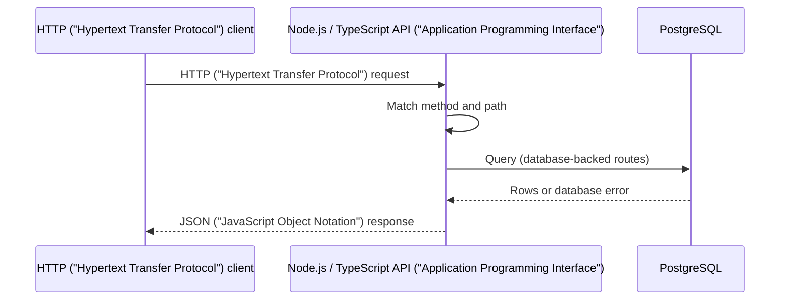

# FlightStack

FlightStack is an evolving **civilian Real-time Drone Operations Platform** for commercial fleets — surveying, inspection, logistics, agriculture, and research. A single project that grows from a simple HTTP ("Hypertext Transfer Protocol") API ("Application Programming Interface") into live telemetry, mission workflows, geospatial operations, event-driven pipelines, cloud deployment, AI ("Artificial Intelligence")-assisted ops, and edge device integration.

A production-shaped system that teaches engineering in layers: each version solves a real problem the previous one handles poorly, without rewriting from scratch.

## Where this is going

Over time, FlightStack is intended to support:

- drone registry, missions, and command history;
- telemetry ingestion, storage, and playback;
- live maps, routes, geofences, and spatial queries;
- realtime updates to flight controllers and operations dashboards;
- reliable event processing (ordering, retries, idempotency);
- secure multi-user access and audit trails;
- cloud deployment with observability and runbooks;
- AI ("Artificial Intelligence")-assisted anomaly summaries and operational tooling;
- physical telemetry from edge hardware over MQTT ("Message Queuing Telemetry Transport").

One codebase, one data model, one operational story — expanded incrementally.

## Evolution path

| Version | Architecture                                            | Focus                                                                                                                     |
| ------- | ------------------------------------------------------- | ------------------------------------------------------------------------------------------------------------------------- |
| V0      | Node.js → PostgreSQL                                    | HTTP ("Hypertext Transfer Protocol"), API ("Application Programming Interface"), SQL ("Structured Query Language"), tests |
| V1      | + Redis, WebSocket                                      | state, realtime, reconnect                                                                                                |
| V2      | + geospatial                                            | PostGIS, coordinates, spatial indexes                                                                                     |
| V3      | + event broker                                          | events, ordering, idempotency, retries                                                                                    |
| V4      | + AWS ("Amazon Web Services"), Terraform                | cloud, IAM ("Identity and Access Management"), networking, IaC ("Infrastructure as Code")                                 |
| V5      | + OpenTelemetry                                         | logs, metrics, traces, reliability                                                                                        |
| V6      | + RAG ("Retrieval-Augmented Generation"), tools, agents | AI ("Artificial Intelligence") systems, evals, permissions                                                                |
| V7      | + ESP32, MQTT ("Message Queuing Telemetry Transport")   | edge sensors, hardware failures                                                                                           |

The active version is always documented in [Current phase](#current-phase-v0) below.

Add a layer when the current version clearly fails at a concrete job.

## Current phase: V0

V0 establishes a clear **HTTP ("Hypertext Transfer Protocol") + PostgreSQL** foundation: a Node.js/TypeScript backend, a reproducible local database, and tests that verify the service and database boundaries.

### In scope

- **Node.js** — runs the backend process.
- **TypeScript** — application source and compile-time checks.
- **HTTP ("Hypertext Transfer Protocol")** — exposes the service API ("Application Programming Interface").
- **PostgreSQL** — stores drone records.
- **Docker Compose** — reproducible local PostgreSQL.
- **Testing** — verifies API ("Application Programming Interface") behavior and the database boundary.

V0 is a **single backend service** with direct request handling: HTTP ("Hypertext Transfer Protocol") routing, application logic, PostgreSQL access, and automated tests.

### Request flow

1. An HTTP ("Hypertext Transfer Protocol") client sends a request to the backend.
2. The HTTP ("Hypertext Transfer Protocol") server matches the method and path.
3. The route invokes the relevant application or database operation.
4. PostgreSQL returns data for database-backed routes.
5. The backend serializes the result as JSON ("JavaScript Object Notation") and sends an HTTP ("Hypertext Transfer Protocol") response.



### Architecture

```mermaid
flowchart LR
    Client[HTTP ("Hypertext Transfer Protocol") client] --> API[Node.js + TypeScript backend]
    API --> Routes[HTTP ("Hypertext Transfer Protocol") routing]
    Routes --> Health[Health operation]
    Routes --> Drones[Drone operations]
    Drones --> DB[(PostgreSQL)]
    Compose[Docker Compose] -. runs .-> DB
    Tests[Automated tests] -. verify .-> API
    Tests -. verify .-> DB
```

Boundaries in V0:

- **HTTP ("Hypertext Transfer Protocol") routing** — decides which operation handles a request.
- **Application operations** — behavior and API ("Application Programming Interface")-shaped results.
- **Database access** — PostgreSQL connections and queries.
- **Tests** — externally visible behavior and the database boundary.

### API ("Application Programming Interface") contract (target)

Endpoints are introduced in implementation issues. This table describes the **target** V0 contract, not a claim that every route already exists.

| Method | Path      | Purpose                                                                  |
| ------ | --------- | ------------------------------------------------------------------------ |
| `GET`  | `/health` | Confirm that the backend process is responding.                          |
| `GET`  | `/drones` | Return the stored drones as a JSON ("JavaScript Object Notation") array. |

Unknown routes and unsupported methods return controlled JSON ("JavaScript Object Notation") errors.

### Development

#### Prerequisites

Install Node.js 24 (see `.nvmrc`) and pnpm 12 or newer. This repository uses pnpm as its package manager — run `pnpm install`, not `npm install`, and prefer `pnpm exec` or `pnpm dlx` over `npx`.

#### Project structure

| Path                            | Responsibility                                                                                                                                   |
| ------------------------------- | ------------------------------------------------------------------------------------------------------------------------------------------------ |
| `docs/testing.md`               | V0 testing approach — runner, levels, commands, database responsibilities                                                                        |
| `packages/api/`                 | V0 HTTP ("Hypertext Transfer Protocol") API ("Application Programming Interface") backend — see [packages/api/README.md](packages/api/README.md) |
| `package.json`                  | Monorepo root scripts that delegate to workspace packages                                                                                        |
| `pnpm-workspace.yaml`           | pnpm workspace package locations                                                                                                                 |
| `.nvmrc`                        | Node.js version for local development                                                                                                            |
| `git-conventional-commits.yaml` | Conventional Commits rules and changelog settings                                                                                                |

#### Scripts

Run from the repository root:

| Script              | Purpose                                                                |
| ------------------- | ---------------------------------------------------------------------- |
| `pnpm install`      | Install dependencies and configure git hooks                           |
| `pnpm dev`          | Compile TypeScript on file changes (`tsc --watch`)                     |
| `pnpm build`        | Compile all workspace packages to their `dist/` directories            |
| `pnpm typecheck`    | Type-check without writing compiler output                             |
| `pnpm start`        | Run the compiled API ("Application Programming Interface") entry point |
| `pnpm test`         | Run automated tests in all workspace packages                          |
| `pnpm api <script>` | Run a script in the `api` package only                                 |

Long-running root scripts (`dev`, `start`) use `pnpm --parallel` so each workspace package can run its own watch or server process concurrently. With one package today that matches running that package’s script directly and stays ready when more packages are added.

#### Verify the setup

```bash
pnpm install
pnpm build
pnpm start
pnpm test
```

`pnpm start` should print a colored startup banner with a clickable `http://localhost:3000/health` link. With the server running, `curl http://localhost:3000/health` should return `{"status":"ok"}`. Git hooks run `pnpm typecheck` before each commit and validate commit messages against `git-conventional-commits.yaml`.
