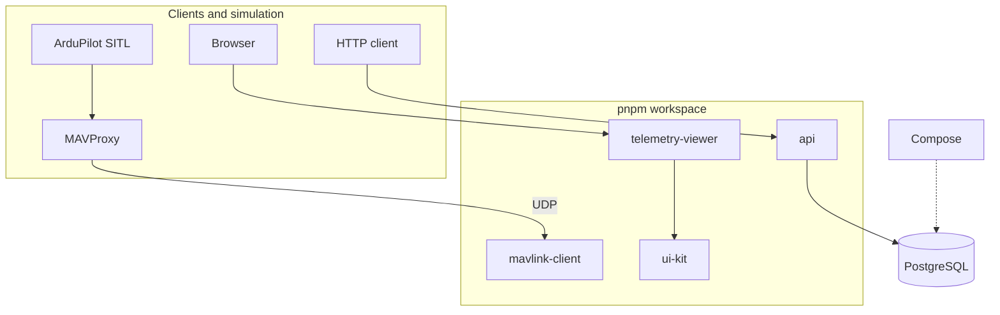

# FlightStack

FlightStack is a **civilian real-time drone operations platform** — surveying, inspection, logistics, agriculture, research. One codebase that grows from a small HTTP ("Hypertext Transfer Protocol") API ("Application Programming Interface") into telemetry, missions, geospatial ops, event pipelines, cloud deployment, AI ("Artificial Intelligence")-assisted tooling, and edge hardware.

Each version fixes a concrete problem the last one couldn't, without a rewrite.

## Evolution path

| Version | Architecture                                            | Focus                                                                                                                     |
| ------- | ------------------------------------------------------- | ------------------------------------------------------------------------------------------------------------------------- |
| V0      | Node.js → PostgreSQL                                    | HTTP ("Hypertext Transfer Protocol"), API ("Application Programming Interface"), SQL ("Structured Query Language"), tests |
| V1      | + Redis, WebSocket                                      | state, realtime, reconnect                                                                                                |
| V2      | + geospatial                                            | PostGIS, coordinates, spatial indexes                                                                                     |
| V3      | + event broker                                          | events, ordering, idempotency, retries                                                                                    |
| V4      | + AWS ("Amazon Web Services"), Terraform                | cloud, IAM ("Identity and Access Management"), networking, IaC ("Infrastructure as Code")                                 |
| V5      | + OpenTelemetry                                         | logs, metrics, traces, reliability                                                                                        |
| V6      | + RAG ("Retrieval-Augmented Generation"), tools, agents | AI ("Artificial Intelligence") systems, evals, permissions                                                                |
| V7      | + ESP32, MQTT ("Message Queuing Telemetry Transport")   | edge sensors, hardware failures                                                                                           |

Active version: [Current phase](#current-phase-v0) below. Add a layer when the current one fails at a real job.

## Current phase: V0

V0 is **HTTP ("Hypertext Transfer Protocol") + PostgreSQL** — one backend service, local database via Compose, tests at the HTTP and database boundaries. A MAVLink ("Micro Air Vehicle Link") UDP client for SITL ("Software In The Loop") and early front-end packages sit alongside the API ("Application Programming Interface"); they are not wired together yet.

### Architecture



**api** — HTTP API ("Application Programming Interface") and PostgreSQL access. **mavlink-client** — UDP telemetry from SITL via MAVProxy. **ui-kit** — shared React UI ("User Interface") for apps. **telemetry-viewer** — map operations shell. Package notes: `packages/*/README.md`.

### Development

Tooling and setup: [docs/prerequisites.md](docs/prerequisites.md). Test approach: [docs/testing.md](docs/testing.md).

Run from the repository root — see `package.json` `scripts` for the full list. Common entry points:

| Script | Purpose |
| ------ | ------- |
| `pnpm install` | dependencies and git hooks |
| `pnpm db:up` / `db:down` / `db:reset` | local PostgreSQL via Compose |
| `pnpm build` / `typecheck` / `lint` / `test` | workspace-wide |
| `pnpm test:integration` | needs `pnpm db:up` first |
| `pnpm start` | build once, run backend servers — `api` (HTTP) and `mavlink-client` (UDP) |
| `pnpm dev` | develop in parallel — backend watch + auto-restart (`api`, `mavlink-client`), Vite on front-end (`ui-kit`, `telemetry-viewer`) |
| `pnpm api` / `mavlink` / `ui-kit` / `viewer` | run a script in one package |

`cp .env.example .env` before first run. Details: [docs/prerequisites.md](docs/prerequisites.md#environment-variables).

```bash
pnpm install && cp .env.example .env && pnpm db:up
pnpm test && pnpm test:integration
pnpm api start    # HTTP API on PORT (default 3000)
```
