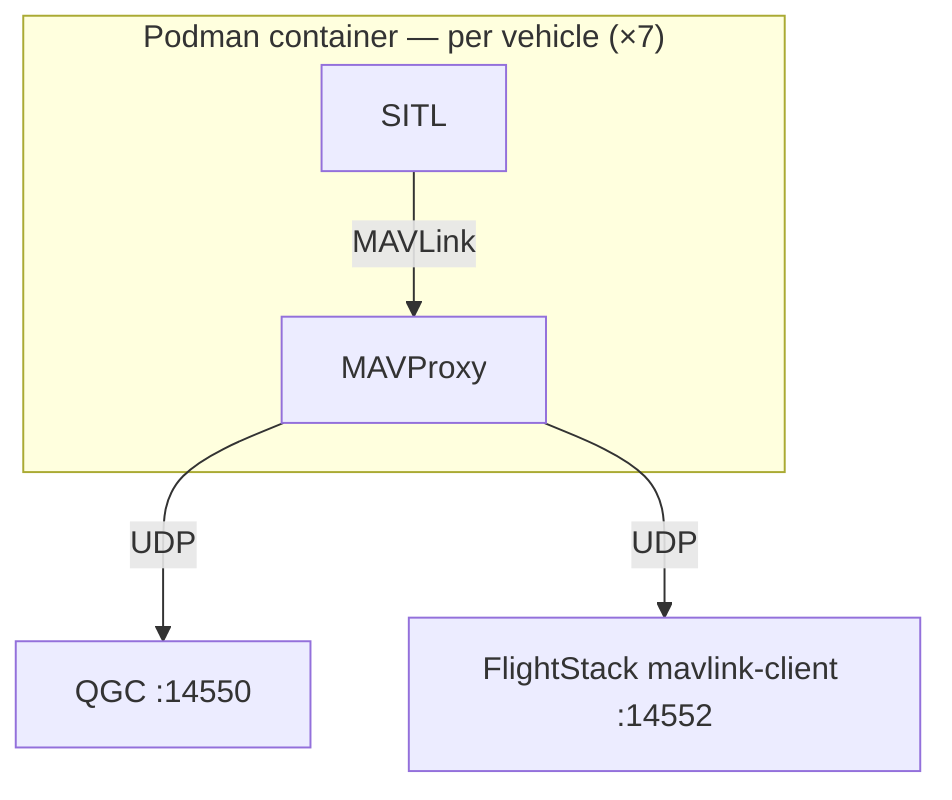

# SITL ("Software In The Loop") fleet

Multi-vehicle ArduPilot SITL for local development. Each vehicle is a **SITL** process plus a **MAVProxy** instance (started by `sim_vehicle.py`). MAVProxy forwards MAVLink ("Micro Air Vehicle Link") to **QGC** ("QGroundControl") and FlightStack on the host — one UDP ("User Datagram Protocol") port per listener. `sysid` identifies each vehicle; no per-drone ports.

## Architecture



Each `sim_vehicle.py` starts one SITL + MAVProxy pair. Every MAVProxy forwards to the same two host endpoints:

- `host.containers.internal:14550` — QGC
- `host.containers.internal:14552` — FlightStack `mavlink-client`

FlightStack receives `sysid` 101–107 on one socket (`MAVLINK_PORT`, default `14552`). That is the intended multi-vehicle model for `mavlink-client`.

## Prerequisites

| Requirement | Notes |
| ----------- | ----- |
| Podman | macOS: `podman machine start` before use |
| ArduPilot checkout | Default path `~/projects/ardupilot` — override `ARDUPILOT_DIR` in the script |
| Container image | `localhost/ardupilot-dev:latest` — see [Container image (one-time)](#container-image-one-time) below |
| ArduPilot Python venv | `~/venv-ardupilot` inside the container — created by `Tools/environment_install/install-prereqs-ubuntu.sh -y` |
| Node.js / pnpm | For `pnpm mavlink start` — see [prerequisites](prerequisites.md) |

### Container image (one-time)

The script expects a local Podman image tagged `localhost/ardupilot-dev:latest`. Any recent Ubuntu base is enough — ArduPilot build deps are installed inside the container on first use:

```bash
podman pull ubuntu:24.04
podman tag ubuntu:24.04 localhost/ardupilot-dev:latest
```

Or tag an existing dev image you already use for ArduPilot builds.

The script creates or reuses a Podman container named `ardupilot-dev`, mounts your ArduPilot tree, activates the ArduPilot Python venv (`~/venv-ardupilot`), then starts the fleet. If `build/sitl/bin/{arducopter,arduplane,ardurover}` are missing, it runs `waf configure` + `waf build` using that venv. Already-built binaries are reused — same as manual `sim_vehicle.py --no-rebuild`.

One-time setup inside the container if the venv is missing:

```bash
podman exec -it ardupilot-dev bash
/ardupilot/Tools/environment_install/install-prereqs-ubuntu.sh -y
```

## Start the fleet

From the repository root:

```bash
podman machine start          # macOS only, if not already running
./scripts/start-sitl.sh       # starts fleet, then drops into container shell
```

The script passes `--mavproxy-args "--daemon"` to each vehicle — required in a headless container where MAVProxy has no TTY. Without it, MAVProxy exits immediately and the fleet tears down.

First run builds SITL binaries inside the container and can take several minutes. Later runs reuse them (`--no-rebuild`).

When the fleet is up, start the MAVLink listener on the host:

```bash
pnpm mavlink start
```

Telemetry from all vehicles arrives on UDP port `14552`. Use `MAVLINK_PORT` and `MAVLINK_HOST` in `.env` if you need different bind settings — see [prerequisites](prerequisites.md#environment-variables).

## Stop the fleet

```bash
./scripts/start-sitl.sh stop
```

This kills SITL and MAVProxy processes inside the container and clears runtime state under `/tmp/flightstack-sitl`.

## QGroundControl

Add a UDP connection on port **14550**. All seven vehicles appear in the vehicle list; select by MAVLink system ID (`sysid`).

## Fleet composition

Defined in [`scripts/sitl-fleet.json`](../scripts/sitl-fleet.json) — single source of truth for fleet composition. The same file supplies log labels in `mavlink-client` on the host.

| Label | ID | Vehicle | Instance | SYSID |
| ----- | -- | ------- | -------- | ----- |
| Copter 101 | copter-101 | ArduCopter | 10 | 101 |
| Copter 102 | copter-102 | ArduCopter | 11 | 102 |
| Copter 103 | copter-103 | ArduCopter | 12 | 103 |
| Plane 104 | plane-104 | ArduPlane | 13 | 104 |
| Rover 105 | rover-105 | Rover | 14 | 105 |
| Rover 106 | rover-106 | Rover | 15 | 106 |
| Boat 107 | boat-107 | Rover (`sailboat-motor`) | 16 | 107 |

- **label** — human name in startup summary and `mavlink-client` logs (`[Copter 101] HEARTBEAT …`)
- **id** — runtime directory name under `/tmp/flightstack-sitl/` and MAVProxy `--aircraft` name
- **sysid** — MAVLink system ID on the wire (what QGC uses in the vehicle list)
- **instance** — local SITL process index (ports inside the container)
- **location** — spawn point as `lat,lon,alt,heading` (degrees)
- **frame** — optional Rover frame (e.g. `sailboat-motor` for the boat)

## Logs and debugging

Per-vehicle logs inside the container:

```bash
podman exec -it ardupilot-dev ls -lah /tmp/flightstack-sitl
podman exec -it ardupilot-dev cat /tmp/flightstack-sitl/copter-101/sim.log
```

Shell into the container:

```bash
podman exec -it ardupilot-dev bash
```

## Configuration

**Fleet** — add, remove, or reposition vehicles in [`scripts/sitl-fleet.json`](../scripts/sitl-fleet.json). Keep `sysid` values unique. After edits, restart the fleet (`./scripts/start-sitl.sh stop`, then `./scripts/start-sitl.sh`).

**Host script** — edit variables at the top of [`scripts/start-sitl.sh`](../scripts/start-sitl.sh) to change paths, container name, or MAVLink endpoints. Defaults:

| Variable | Default |
| -------- | ------- |
| `CONTAINER` | `ardupilot-dev` |
| `IMAGE` | `localhost/ardupilot-dev:latest` |
| `ARDUPILOT_DIR` | `~/projects/ardupilot` |
| `PODMAN_MACHINE` | `podman-machine-default` |
| `QGC_ENDPOINT` | `host.containers.internal:14550` |
| `FLIGHTSTACK_ENDPOINT` | `host.containers.internal:14552` |
