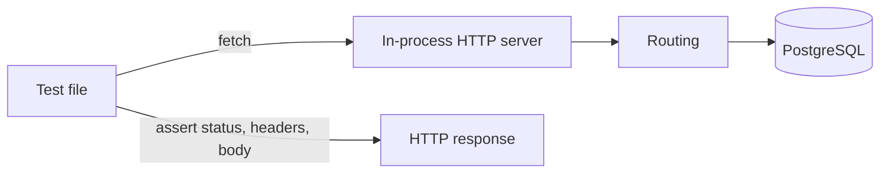

# Testing approach (V0)

FlightStack V0 verifies behavior through automated tests that observe the service from the outside — HTTP ("Hypertext Transfer Protocol") requests and responses, and later PostgreSQL — rather than asserting on internal implementation details.

## Test runner

V0 uses the **Node.js built-in test runner** (`node:test`) with **`node:assert/strict`** for assertions. No separate test framework (Jest, Vitest, Mocha, and similar) is added in V0.

| Choice | Reason |
| ------ | ------ |
| `node:test` | Stable in Node.js 24, zero extra dependencies, fits a small HTTP ("Hypertext Transfer Protocol") API ("Application Programming Interface") |
| `node:assert/strict` | Built-in, strict equality checks, clear failure output |
| TypeScript compiled before run | Default tests use `src/**/*.test.ts`; PostgreSQL tests use `src/integration/**/*.integration.test.ts` |

This keeps the toolchain aligned with the rest of V0: Node.js, TypeScript, and minimal surface area.

## Test levels in V0

V0 defines three levels. Only the first two are used today; the third is explicitly out of scope until a later version needs it.

### Unit tests

**What they prove:** isolated logic — pure functions, small modules — without starting an HTTP ("Hypertext Transfer Protocol") server or connecting to PostgreSQL.

**What they do not prove:** routing, serialization, status codes, or database behavior.

**V0 usage:** sparingly. Add a unit test when logic is worth exercising without I/O ("Input/Output") — for example, a validation helper or a SQL ("Structured Query Language") builder with no live connection. Most V0 confidence comes from integration tests at the HTTP ("Hypertext Transfer Protocol") boundary.

**Location:** `packages/api/src/**/*.test.ts` (default) and `packages/api/src/integration/**/*.integration.test.ts` (PostgreSQL), compiled to `dist/`.

### Integration tests

**What they prove:** the API ("Application Programming Interface") behaves correctly when exercised like a real client — real HTTP ("Hypertext Transfer Protocol") requests against an in-process server, and (when database routes exist) real PostgreSQL queries and responses.

**What they do not prove:** behavior of separate deployable processes, browser UI ("User Interface"), or infrastructure outside this repository.

**V0 usage:** primary test level. HTTP ("Hypertext Transfer Protocol") tests in `packages/api/src/app.test.ts` start `createServer()`, send `fetch` requests to a random local port, and assert status, headers, and JSON ("JavaScript Object Notation") body. Database-backed routes will follow the same pattern: HTTP ("Hypertext Transfer Protocol") in, observable response out, with a running PostgreSQL instance.



### End-to-end tests

**What they would prove:** the full system from an external client through deployed or compose-orchestrated services.

**V0 decision:** **not in scope.** V0 is a single backend service; integration tests at the HTTP ("Hypertext Transfer Protocol") and database boundaries provide enough confidence without a separate E2E ("End-to-End") runner, browser automation, or multi-process orchestration in CI ("Continuous Integration"). Revisit when multiple services or a UI ("User Interface") make “whole system” behavior the main risk.

## Test commands

Run from the **repository root**:

| Command | Purpose |
| ------- | ------- |
| `pnpm test` | Run default tests in every workspace package — no PostgreSQL |
| `pnpm test:integration` | Run integration tests in every workspace package — PostgreSQL must be running |
| `pnpm api test` | Run default tests in the `api` package only |
| `pnpm db:up` | Start local PostgreSQL and Adminer (`podman compose up -d`) |
| `pnpm db:down` | Stop Compose services |
| `pnpm db:reset` | Remove database volume and start fresh |

Inside `packages/api`, `pnpm test` runs `tsc` then default tests from `dist/*.test.js`. `pnpm test:integration` runs `tsc` then tests from `dist/integration/`. Run `pnpm clean` in that package if stale files remain in `dist/` after renames.

| Location | Package script | Requires PostgreSQL |
| -------- | -------------- | ------------------- |
| `src/**/*.test.ts` | `test` | No |
| `src/integration/**/*.integration.test.ts` | `test:integration` | Yes |

**Local full check** (before push or when validating database work):

```bash
pnpm db:up
pnpm test && pnpm test:integration
```

**CI ("Continuous Integration")** will start a PostgreSQL service and run both commands when a pipeline is added — local developers use the same sequence manually until then.

**Prerequisites for HTTP-only tests:** `pnpm install` and a successful `pnpm build` are not required separately — `pnpm test` compiles as part of the test script.

**Prerequisites for database integration tests (when added):** a running PostgreSQL instance (see [Database setup and cleanup](#database-setup-and-cleanup)) and any required environment variables documented alongside those tests.

## Database setup and cleanup

Database integration tests are introduced when API ("Application Programming Interface") routes read or write PostgreSQL (for example `GET /drones`). Until then, tests do not require a database.

### Who provides PostgreSQL

| Responsibility | Owner |
| -------------- | ----- |
| Run PostgreSQL locally for development and tests | Developer — via `podman compose up -d` or `docker compose up -d` (see [README](../README.md#postgresql)) |
| Connection settings (host, port, database, user) | `DATABASE_URL` in `.env` — see [README](../README.md#environment-configuration) |
| Schema (tables, columns) | SQL ("Structured Query Language") migration or init scripts applied before tests that need a known schema |

Tests assume PostgreSQL is **already running** and reachable at the configured connection string. The test suite does not start Docker for you in V0.

### Setup before database tests

1. Start PostgreSQL (`podman compose up -d` or `docker compose up -d`).
2. Apply the schema so tables such as `drones` exist.
3. For each test file or suite that needs a known state: insert seed rows, or rely on an empty table when testing the empty response.

Document any required env vars (for example `DATABASE_URL`) in the test file header or in the operational workflow doc when it exists.

### Cleanup between tests

Predictable tests require **controlled or isolated state**. V0 uses simple, explicit strategies — no heavy test harness:

| Strategy | When to use |
| -------- | ----------- |
| **Truncate or delete test rows** after each test or suite | Default for V0; clear tables written by tests so the next run starts clean |
| **Dedicated seed data per test** with cleanup in `afterEach` | When tests insert specific drones and must not leak rows |
| **Empty table as initial state** | When verifying `GET /drones` returns `[]` before any inserts |

Transactions rolled back per test are acceptable later if they simplify isolation; V0 prioritizes clarity over cleverness.

### Failure behavior

Tests that require PostgreSQL should **fail clearly** when the database is unreachable or misconfigured — not pass silently or skip without notice. Dedicated issues cover connectivity checks and database error responses.

## What V0 does not test (yet)

Keeping the approach proportionate to V0 means deferring:

- separate E2E ("End-to-End") or browser automation;
- load, performance, or chaos testing;
- multi-service or cloud deployment verification;
- exhaustive unit coverage of every line when integration tests already prove the contract.

Add depth when a real failure mode appears — for example, more database edge cases after `GET /drones` ships, or CI ("Continuous Integration") gates after the pipeline exists.

## Related documentation

- Root [README.md](../README.md) — V0 scope, scripts, and verification steps
- [packages/api/README.md](../packages/api/README.md) — API ("Application Programming Interface") package layout and endpoints
