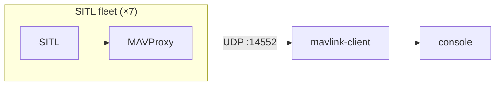

# MAVLink Client

UDP ("User Datagram Protocol") MAVLink ("Micro Air Vehicle Link") listener for local SITL ("Software In The Loop") development. Receives frames from MAVProxy, parses with `node-mavlink`, logs telemetry to the console. Standalone from the API and viewer today.



All vehicles share one UDP port. MAVLink `sysid` in each packet header identifies the vehicle — no per-drone ports. Log lines are prefixed with fleet labels from [`scripts/sitl-fleet.json`](../../scripts/sitl-fleet.json) when present (e.g. `[Copter 101] HEARTBEAT …`); otherwise the tag falls back to `sysid N`. Fleet launcher and wiring: [docs/sitl.md](../../docs/sitl.md).

```bash
./scripts/start-sitl.sh    # start SITL fleet (see sitl.md)
pnpm mavlink start         # listen on MAVLINK_PORT (default 14552)
```

Ports and env vars: [prerequisites](../../docs/prerequisites.md).
