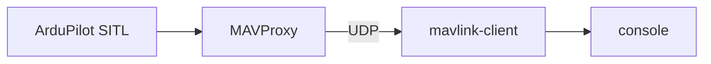

# MAVLink Client

UDP ("User Datagram Protocol") MAVLink ("Micro Air Vehicle Link") listener for local SITL ("Software In The Loop") development. Receives frames from MAVProxy, parses with `node-mavlink`, logs telemetry to the console. Standalone from the API and viewer today.



SITL setup: QGC ("QGroundControl") or equivalent → MAVProxy → `output add 127.0.0.1:14552` → `pnpm mavlink start`. Ports and env vars: [prerequisites](../../docs/prerequisites.md).

```bash
pnpm mavlink start
```
